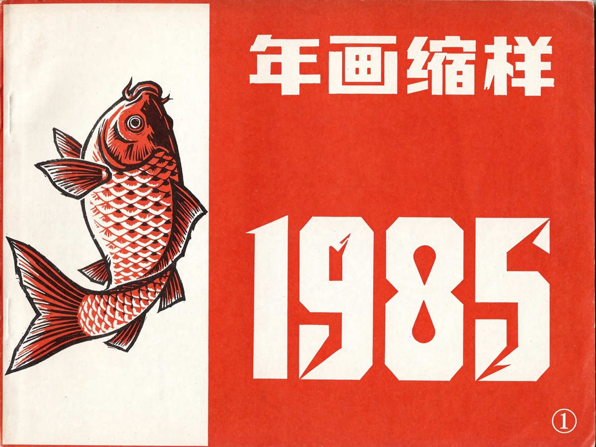
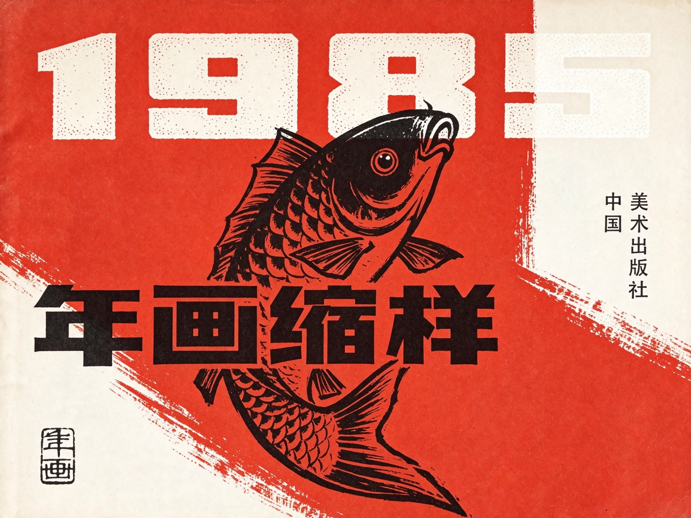
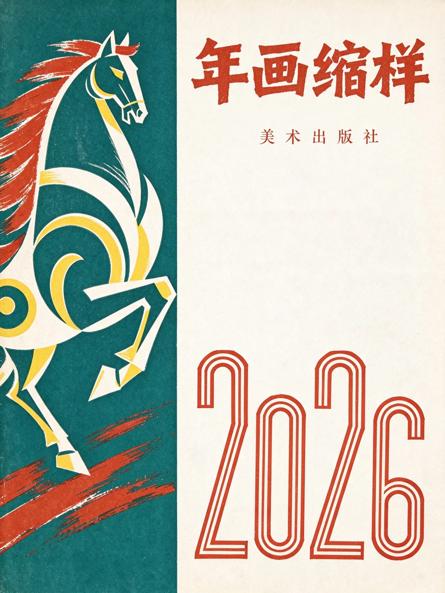
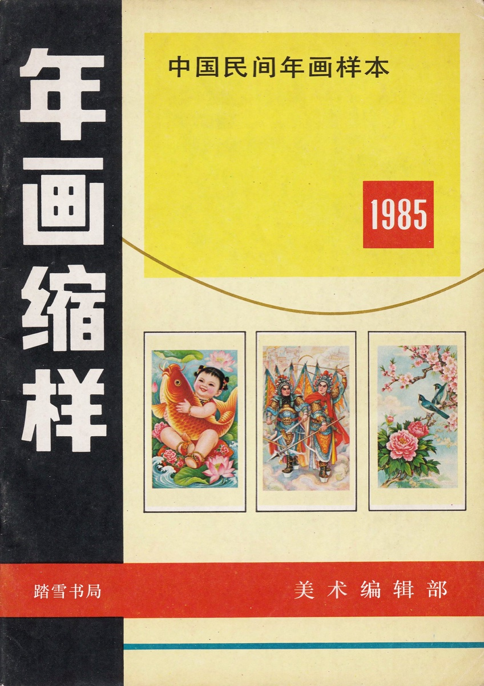
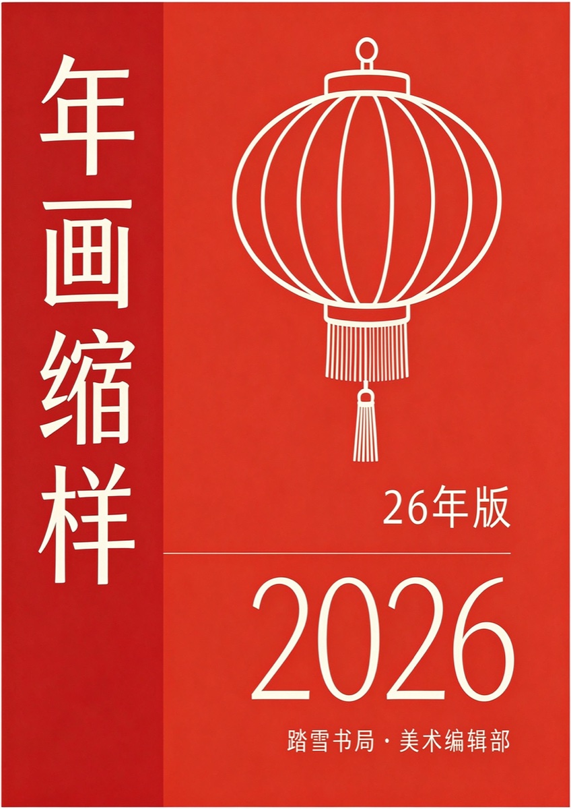

# 效果图画廊

以下为 `scripts/compose_prompt.py` 生成的提示词在即梦（Jimeng）上的出图实测，共 5 张。每张标注其演示的风格、断代、载体与画面要点。

> 效果图版权独立于 Skill（MIT），禁止商业使用，见 [LICENSE-IMAGES.md](LICENSE-IMAGES.md)。

---

## 1. 年画缩样 × 1980s × 剪纸线刻 × 4:3 横版

- **风格**：`nianhua-suoyang`（年画缩样）
- **断代**：1980s
- **载体**：4:3 横版封面
- **画面要点**：朱红与米白对割，左侧民间剪纸锯齿线刻鲤鱼，右侧黑体「年画缩样」与超大斜体「1985」。提示词正文无括号元标签，年份与书名分区锁字。

## 2. 年画缩样 × 1980s × 专色高对比 × 4:3 横版

- **风格**：`nianhua-suoyang`（年画缩样）
- **断代**：1980s
- **载体**：4:3 横版封面
- **画面要点**：朱红满底，黑白木刻鲤鱼跃出，顶部反白「1985」，底部黑体「年画缩样」配阴文篆刻方印。演示专色高对比与篆刻饰件。

## 3. 年画缩样 × 2026 × 大留白 × 3:4 竖版

- **风格**：`nianhua-suoyang`（年画缩样）
- **断代**：1980s 基因 × 2026 年份
- **载体**：3:4 竖版封面
- **画面要点**：墨绿底配朱红与明黄奔马，右侧大留白排「年画缩样」「美术出版社」与空心「2026」。演示大留白与建筑化手工书名字。

## 4. 年画缩样 × 1980s × 几何构成 × 32 开

- **风格**：`nianhua-suoyang`（年画缩样）
- **断代**：1980s
- **载体**：32 开竖版
- **画面要点**：黄底黑体竖排「年画缩样」，三格年画样张陈列，红色「1985」块，底部「踏雪书局 / 美术编辑部」。演示几何构成与样张陈列版式。

## 5. 年画缩样 × 2026 × 中国红 × 32 开

- **风格**：`nianhua-suoyang`（年画缩样）
- **断代**：2026 年份
- **载体**：32 开竖版
- **画面要点**：中国红满底，白描灯笼，左侧竖排「年画缩样」，下方「26年版」「2026」「踏雪书局·美术编辑部」。演示专色满底与竖排锁字。
